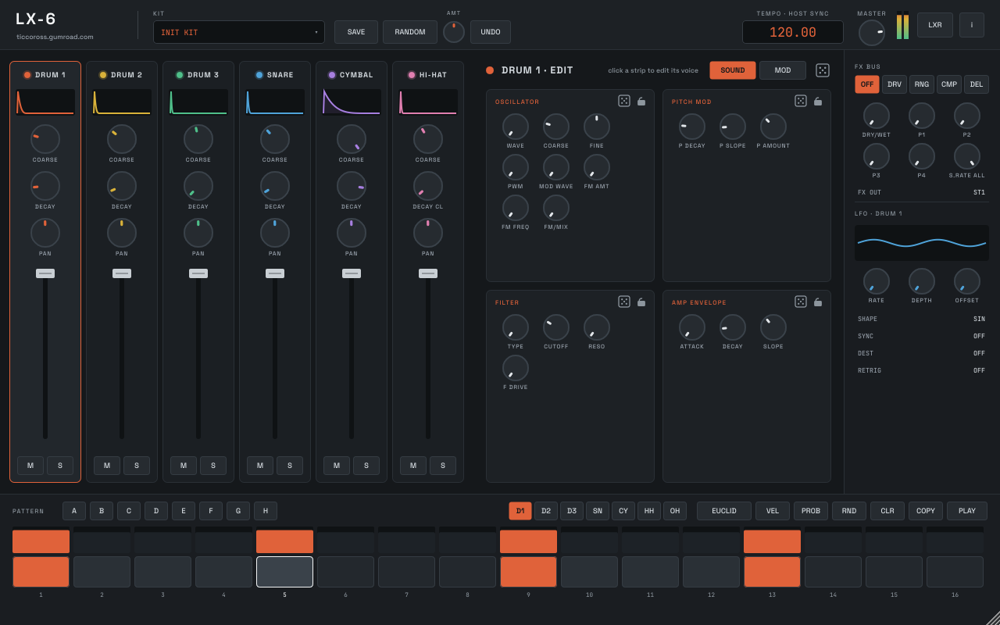

# LX-6

**A six-voice digital drum synthesizer plugin (AU / VST3 / standalone) with a 16-step sequencer, based on the open-source Erica Synths LXR firmware.**

Made by **Ticco Ross** — [ticcoross.gumroad.com](https://ticcoross.gumroad.com/) · ticcoross@gmail.com



## What it is

LX-6 runs the actual sound engine of the LXR drum machine firmware — the same C code — inside a plugin:

- **6 voices**: Drum 1–3, Snare, Cymbal, Hi-hat (closed + open), with the LXR's oscillators, FM, noise, transients, pitch and amp envelopes, filters, drive, sample-rate reduction, velocity modulation and one LFO per voice
- **FX bus**: drive, ring modulator, compressor, delay / ping-pong
- **16-step sequencer**: 7 tracks × 8 patterns, velocity and probability per step, Euclidean generator, random patterns, swing, host sync
- **Randomizer**: whole kit, one voice or one section, with an amount control, section locks and undo
- **LXR-02 hardware editor**: every knob, the randomizer and the sequencer can also drive a real Erica Synths LXR-02 over MIDI
- **Two stereo outputs** (Out 2 is the LXR's second output; when it is not enabled everything is mixed to the main output)

Every sound parameter is automatable. MIDI notes C1–F#1 (36–42) play Drum 1, Drum 2, Drum 3, Snare, Cymbal, Closed HH, Open HH.

## Downloads

Installers for macOS (universal, AU + VST3 + app) and Windows (VST3 + app) are on the [Releases](https://github.com/Spunkmeyer77/LX6/releases) page, with the PDF manual.

## Building

Needs CMake 3.22+ and a C/C++17 compiler. JUCE is downloaded automatically.

```
# macOS
cmake -B build -G Ninja -DCMAKE_BUILD_TYPE=Release -DCMAKE_OSX_ARCHITECTURES="arm64;x86_64"
cmake --build build --target LX6_AU LX6_VST3 LX6_Standalone

# Windows (the firmware C code needs clang-cl)
cmake -B build -G "Visual Studio 17 2022" -A x64 -T ClangCL
cmake --build build --config Release --target LX6_VST3 LX6_Standalone
```

`-DLX6_BUILD_TESTS=ON` adds `LX6Test`, an offline smoke test (audio, randomizer, hardware MIDI, UI snapshots).

## How the engine is ported

`engine/lxr` holds the LXR firmware's sound engine, MIDI parameter handling and sequencer sources. `engine/host` replaces the
STM32 hardware layer (codec, front panel, LEDs, SD card) with small stubs and wraps the engine in a C interface
(`lx6_engine.h`). The engine still runs at the LXR's own 44.14 kHz in 64-sample blocks; the plugin resamples to the host rate.
Changes to the firmware files are marked `LX6_HOST` (desktop-safe memory access and portable versions of ARM instructions).

`tools/gen_params.py` reads the parameter types, menu names and the init kit from the firmware sources and generates
`Source/LxrParamTable.h`.

The LXR engine is a single set of global variables, so only **one LX-6 per project** can run the sound engine. Extra instances
show a notice and still work as hardware editor + sequencer.

## Licence

LX-6 is free software under the **GNU General Public License v3** (see [LICENSE](LICENSE) and [NOTICE.md](NOTICE.md)).

The sound engine comes from the [LXR firmware](https://github.com/erica-synths/lxr-desktop-app), Copyright (C) 2012–2026 Erica Synths,
GPL-3.0-only. "Erica Synths", "LXR" and "LXR-02" are trademarks of Erica Synths. **LX-6 is an independent product and is not
made, approved or endorsed by Erica Synths.**
